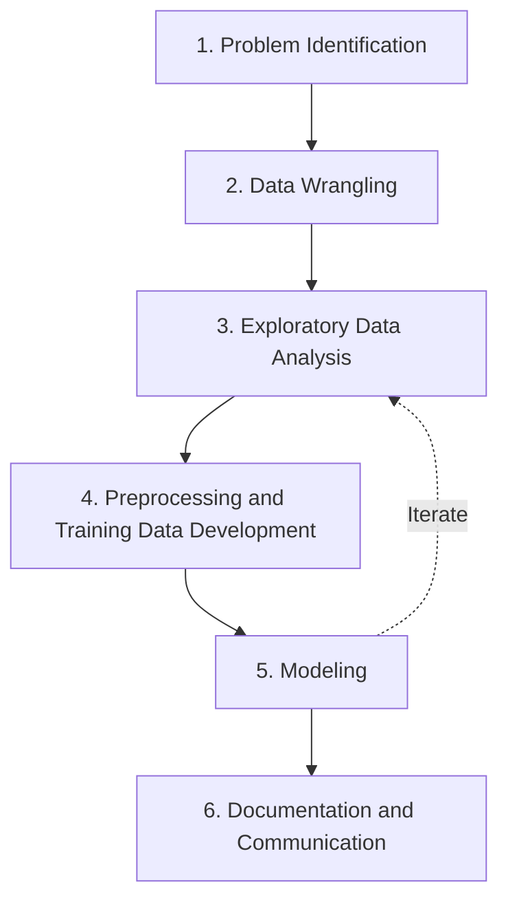

# Springboard | Data Science & Machine Learning Portfolio


A collection of applied data science projects and case studies developed through the Springboard data science curriculum. This repository explores how statistical analysis, machine learning, deep learning, and data engineering can be used to investigate real-world problems and support informed decisions.

The portfolio covers regression, classification, computer vision, financial analytics, statistical inference, unsupervised learning, model optimization, and big data processing.

## Table of Contents

- [Featured Projects](#featured-projects)
- [Mini-Projects and Case Studies](#mini-projects-and-case-studies)
- [Technical Toolkit](#technical-toolkit)
- [Data Science Workflow](#data-science-workflow)
- [Repository Structure](#repository-structure)
- [Getting Started](#getting-started)
- [Limitations and Future Improvements](#limitations-and-future-improvements)
- [About the Author](#about-the-author)

## Featured Projects

| Project | Application | Methodology | Recorded result / output |
|---|---|---|---|
| [Capstone I — Ski Resort Pricing](./CAPSTONE%20PROJECT%201) | Business analytics | Multiple linear regression | $5.09 MAE; 0.937 explained variance |
| [Capstone II — Cardiovascular Disease Prediction](./CAPSTONE%20PROJECT%202) | Healthcare analytics | Logistic regression, SVM, decision tree | 73.26% accuracy with a decision tree |
| [Capstone III — Facial Image Age Estimation](./CAPSTONE%20PROJECT%203) | Computer vision | Convolutional neural network (CNN) | 23,705 images; 48 × 48 pixel inputs |
| [Credit Card Fraud Detection](./Credit%20Card%20Fraud%20Detection) | Financial analytics | Fraud detection project | See project folder |

> Results are historical notebook outputs, not independently reproduced benchmarks. See the validation notes below before interpreting the metrics.

### 01 · Ski Resort Ticket Price Prediction

**Objective:** Estimate an appropriate adult weekend lift-ticket price for Big Mountain Resort using the characteristics and prices of comparable ski resorts.

**Approach**

- Prepare resort-level features, including terrain, snowfall, operating days, lift infrastructure, and adult weekday ticket prices.
- Standardize numerical features and create a 75/25 training and testing split.
- Fit a multiple linear regression model and evaluate its predictions using mean absolute error and explained variance.
- Examine model coefficients and visualize resort characteristics using previously generated cluster labels.
- Serialize the regression estimator with Joblib and export a model documentation table.

**Recorded results**

| Metric | Value |
|---|---:|
| Mean absolute error (MAE) | $5.09 |
| Explained variance score | 0.9365 |
| Existing Big Mountain weekend ticket price | $81.00 |
| Model-estimated weekend ticket price | $87.88 |

The model estimated a weekend price approximately $6.88 above the recorded price. This illustrates how predictive analytics can inform a pricing discussion; it does not establish an optimal price or a causal revenue impact.

**Tools:** Python, pandas, NumPy, scikit-learn, Matplotlib, Seaborn, Joblib  
**Notebook reviewed:** `Notebook_stepsix.ipynb`  
**Data input:** `step3_output.csv`

[Explore Capstone I →](./CAPSTONE%20PROJECT%201)

### 02 · Cardiovascular Disease Prediction

**Objective:** Investigate whether demographic, clinical, and lifestyle variables can predict the presence of cardiovascular disease in a binary classification dataset.

**Approach**

- Use preprocessed data containing age, blood pressure, cholesterol, glucose, BMI, and lifestyle indicators.
- Standardize numerical variables and create an 80/20 train/test split; the later notebook uses stratification.
- Compare logistic regression, support vector machines, and a decision tree classifier.
- Explore feature reduction by removing height and weight while retaining BMI.
- Examine model coefficients, confusion matrices, precision, F1 scores, and recorded ROC-AUC values.

**Recorded model comparison**

| Model | Accuracy | F1 score |
|---|---:|---:|
| Logistic regression — full feature set | 72.80% | 0.7082 |
| Logistic regression — reduced feature set | 72.85% | 0.7087 |
| SVM — linear kernel | 71.85% | 0.6824 |
| SVM — sigmoid kernel | 50.74% | 0.0000 |
| Decision tree — maximum depth of 5 | **73.26%** | **0.7125** |

The decision tree recorded the highest accuracy and F1 score among the models with completed results in the supplied notebook. Other SVM kernels were included in the code, but complete outputs were not available. Random forest was imported, but a fitted random forest result was not documented in the supplied notebook.

**Tools:** Python, pandas, NumPy, scikit-learn, Matplotlib, Seaborn  
**Notebooks reviewed:** `Pre-Processing and Training Data Development.ipynb` and `Pre-Processing and Training Data Development2 (1).ipynb`  
**Data input:** `ready_data.csv`

This is an educational machine learning experiment, not a clinically validated diagnostic tool.

[Explore Capstone II →](./CAPSTONE%20PROJECT%202)

### 03 · Facial Image Age Estimation Using Deep Learning

**Objective:** Develop a computer vision regression model that estimates age from facial images using a convolutional neural network.

**Dataset and architecture**

| Component | Description |
|---|---|
| Dataset | 23,705 image records |
| Image dimensions | 48 × 48 pixels, single channel |
| Prediction target | Age |
| Initial split | 80% training / 20% testing |
| Framework | TensorFlow / Keras |
| Architecture | Convolution, batch normalization, max pooling, dropout, dense layers |
| Optimizer | Adam |
| Loss function | Mean squared error (MSE) |
| Evaluation metric | Mean absolute error (MAE) |

**Approach**

- Inspect dataset structure, missing values, duplicate records, and age and demographic distributions.
- Convert image pixels into arrays and reshape them into CNN-compatible tensors.
- Build a deep learning regression model with a single numerical output.
- Review training and validation curves and compare example predicted ages with actual ages.

**Validation note:** The notebook records a final evaluation MAE of 9.43 years, but the model was additionally fitted on the original test partition before that evaluation. Consequently, this value is not an independent holdout performance estimate. A fresh, untouched test set and a subgroup error analysis are needed before making generalization claims.

**Tools:** Python, TensorFlow, Keras, pandas, NumPy, Matplotlib, Seaborn, Plotly  
**Notebook reviewed:** `Capstone III (1).ipynb`  
**Data input:** `age_gender.csv`

[Explore Capstone III →](./CAPSTONE%20PROJECT%203)

### 04 · Credit Card Fraud Detection

A dedicated project folder focused on the application of data science to fraudulent credit card transactions. The folder is included in the repository index; its notebooks and model results were not part of the material reviewed for this README.

[Explore Credit Card Fraud Detection →](./Credit%20Card%20Fraud%20Detection)

## Mini-Projects and Case Studies

The [mini-project collection](./MINI-PROJECTS) complements the capstone work with focused exercises in statistics, machine learning, data processing, and practical problem solving.

| Area | Projects and topics |
|---|---|
| Data acquisition and big data | API Mini-Project; Big Data: Spark and PySpark — Databricks Edition |
| SQL and relational analysis | SQL Case Study — Country Club |
| Statistical inference | Inferential Statistics; Hypothesis Testing in Python — Integrating Apps |
| Statistical modeling | Statistical Modeling in Python; Logistic Regression Advanced Case Study |
| Tree-based learning | Random Forest — COVID-19 Case Study; Decision Trees — RR Diner Coffee |
| Ensemble learning | Gradient Boosting and AdaBoost |
| Hyperparameter optimization | Bayesian Optimization; Grid Search in KNN |
| Similarity and distance | Cosine Similarity; Euclidean and Manhattan Distances |
| Unsupervised learning | Principal Components Analysis; Customer Segmentation using Clustering |
| Time series analysis | Cowboy Cigarettes — A Time Series Investigation |
| Applied challenges | London Calling; Relax Challenge; Ultimate Data Science Challenge |
| Problem formulation | Monalco and Nordic Sensing Problem Statement Worksheets |

## Technical Toolkit

| Discipline | Technologies and techniques |
|---|---|
| Programming and querying | Python, SQL |
| Data preparation | pandas, NumPy, feature scaling, data cleaning, feature selection |
| Statistical analysis | Inferential statistics, hypothesis testing, regression, time series |
| Machine learning | scikit-learn, logistic regression, decision trees, SVM, ensemble methods, KNN |
| Unsupervised learning | PCA, clustering, similarity and distance measures |
| Deep learning | TensorFlow, Keras, convolutional neural networks |
| Visualization | Matplotlib, Seaborn, Plotly |
| Big data | Apache Spark, PySpark, Databricks |
| Model evaluation and optimization | Accuracy, precision, F1, MAE, explained variance, ROC-AUC, grid search, Bayesian optimization |
| Development and documentation | Jupyter Notebook, GitHub, Joblib, Pickle |

## Data Science Workflow

The capstone projects follow the six-stage data science methodology used in the curriculum:



From defining a problem to communicating model results, the emphasis is on linking analytical methods to practical questions and documenting the decisions made throughout the process.

## Repository Structure

```text
Springboard/
├── CAPSTONE PROJECT 1/             # Ski resort pricing
├── CAPSTONE PROJECT 2/             # Cardiovascular disease prediction
├── CAPSTONE PROJECT 3/             # Facial image age estimation
├── CAREER-RELATED/                 # Career-related materials
├── Credit Card Fraud Detection/    # Financial analytics project
├── MINI-PROJECTS/                  # Exercises and applied case studies
└── README.md
```

## Getting Started

Clone the repository and create a Python environment:

```bash
git clone https://github.com/KingdomDataScience/Springboard.git
cd Springboard
python -m venv .venv
```

Activate the environment:

```bash
# Windows PowerShell
.venv\Scripts\Activate.ps1

# macOS / Linux
source .venv/bin/activate
```

Install common dependencies for the reviewed notebooks:

```bash
python -m pip install jupyter pandas numpy scikit-learn matplotlib seaborn plotly tensorflow joblib pillow
```

Launch Jupyter:

```bash
jupyter notebook
```

Navigate to the project folder of interest. The historical notebooks may require compatible package versions, project-specific datasets, additional dependencies, and updates to hard-coded local paths. The installation command is a starting point, not a tested lockfile. Spark exercises may also require a configured Spark or Databricks environment.

## Limitations and Future Improvements

This repository preserves earlier educational work and provides a foundation for further development. Priorities for improving reproducibility and evaluation include:

- Fit preprocessing transformations on training data only, preferably using scikit-learn pipelines. The reviewed pricing and cardiovascular notebooks contain scaling operations fitted before or across the train/test split.
- Re-evaluate the CNN using a new, untouched test partition and assess errors across age ranges and demographic subgroups.
- Compute ROC-AUC from prediction probabilities or decision scores, complete the interrupted model comparisons, and add cross-validation.
- Save the full preprocessing and modeling pipeline rather than the fitted estimator alone.
- Replace machine-specific paths, document data provenance and permissions, and add pinned dependencies, tests, and project-specific READMEs.
- Review personal images and any sensitive data before publishing notebooks or datasets.

## About the Author

### Lucien Meteumba, Ph.D.

**Senior Data Scientist | AI/ML Practitioner | Computational Engineering Researcher**

Lucien Meteumba is a dedicated Senior Data Scientist with a Ph.D. in Computational Engineering, specializing in Numerical Mathematics and Data Science, and over eight years of professional experience designing, developing, and deploying data-driven solutions across healthcare, banking and financial services, defense, government, and commercial enterprises.

His expertise spans statistical modeling, machine learning, deep learning, natural language processing (NLP), artificial intelligence, data engineering, and MLOps. He combines rigorous mathematical foundations with hands-on engineering to solve complex real-world problems and translate analytical findings into actionable insights for technical teams and decision-makers.

He has experience across the full machine learning lifecycle, from data acquisition, exploratory analysis, and feature engineering to model development, experiment tracking, evaluation, deployment, and operationalization. His technical toolkit includes Python, SQL, Palantir Foundry, PyTorch, TensorFlow, scikit-learn, MLflow, and web-based deployment technologies.

#### Professional Areas of Expertise

| Domain | Expertise |
|---|---|
| Artificial Intelligence & Machine Learning | Predictive modeling, supervised and unsupervised learning, ensemble methods |
| Deep Learning & Computer Vision | Neural networks, CNNs, PyTorch, TensorFlow |
| Natural Language Processing | NLP modeling, text analytics |
| Statistical & Mathematical Modeling | Regression, statistical inference, differential equations, numerical analysis, dynamical systems |
| Data Engineering | Data pipelines, SQL, Palantir Foundry, PySpark |
| MLOps | Experiment tracking, MLflow, model evaluation and deployment |
| Scientific Research | Computational engineering, healthcare analytics, Alzheimer's disease research |

#### Research Contributions

His doctoral research focused on the intersection of mathematical modeling, machine learning, and Alzheimer's disease. His research contributions include:

- Lead-authoring a study benchmarking XGBoost, Extra Trees, and neural networks using National Alzheimer's Coordinating Center (NACC) data, achieving a reported accuracy of 96.91% in predicting cognitive status.
- Developing a 24-equation ordinary differential equation (ODE) model to investigate oxidative stress dynamics in Alzheimer's disease.
- Applying numerical methods, sensitivity analysis, and dynamical systems theory to complex biological processes.
- Contributing to the scientific community through three peer-reviewed publications.

**Professional Mission:** To leverage mathematics, data science, and artificial intelligence to solve meaningful problems, drive innovation, and develop intelligent, scalable, and impactful solutions.

[View Lucien Meteumba's GitHub profile](https://github.com/KingdomDataScience)

---

*Developed as part of the Springboard data science learning journey. Projects are intended for educational and portfolio purposes.*

